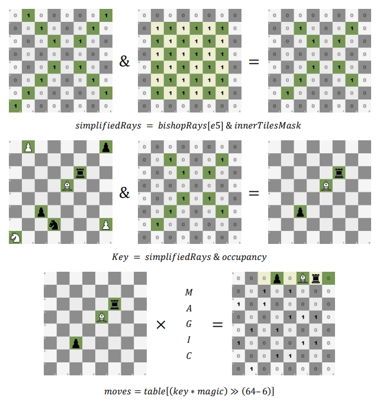
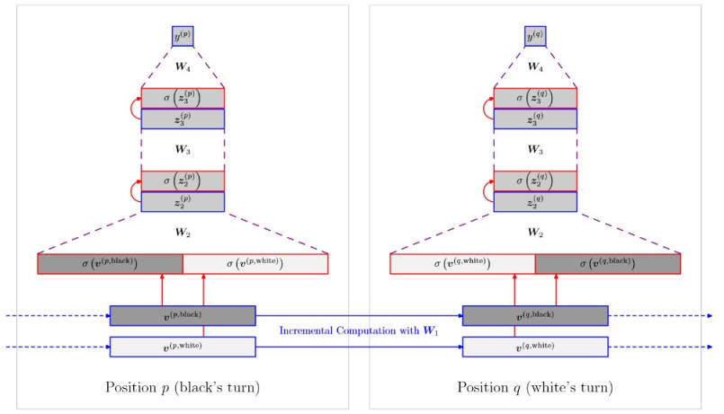
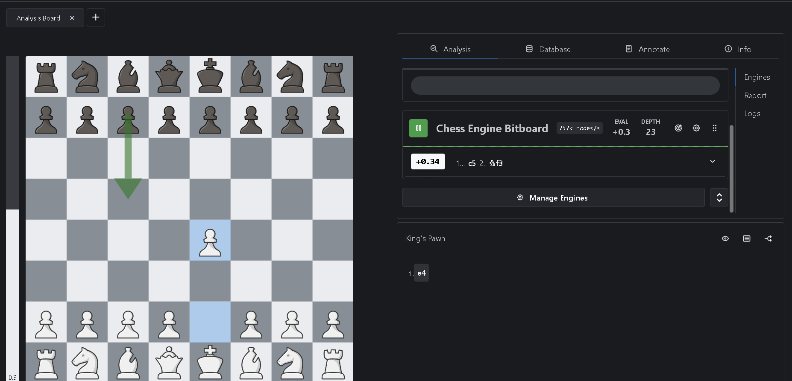
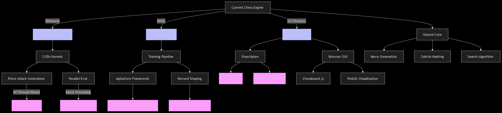

# High-Performance Chess Engine using Bitboards and NNUE

A high-performance chess engine written in **C**, combining efficient board representation, fast move generation, alpha-beta/PVS search, and **NNUE (Efficiently Updatable Neural Network)** position evaluation. The project focuses on correctness and CPU-level performance using **magic bitboards**, **incremental neural evaluation**, and **AVX2 SIMD optimization**.

## Highlights

- 64-bit bitboard board representation
- Magic bitboards for fast bishop, rook, and queen attacks
- NNUE-based position evaluation
- Incremental NNUE accumulator updates to avoid full recomputation after every move
- AVX2 SIMD acceleration for neural evaluation on supported CPUs
- Principal Variation Search / alpha-beta search with multiple pruning and ordering techniques
- Transposition table with Zobrist hashing
- UCI support for use with chess GUIs
- Move-generation validation using perft testing
- Performance-oriented implementation designed for high nodes-per-second search

## Project Architecture

```text
                UCI / GUI
                   |
                   v
            Position / FEN
                   |
                   v
          Bitboard Board State
                   |
          +--------+--------+
          |                 |
          v                 v
    Move Generation     NNUE Evaluation
    - Leapers           - Incremental accumulator
    - Magic bitboards   - SIMD / AVX2
          |                 |
          +--------+--------+
                   |
                   v
              PVS Search
        Alpha-Beta + Pruning
                   |
                   v
               Best Move
```

## Bitboard Representation

The engine represents chess-board information using **64-bit integers**. Since a chess board contains 64 squares, each bit corresponds directly to one square.

For example, setting square `i` in a bitboard can be done with:

```c
board |= (1ULL << i);
```

This representation makes operations such as adding, removing, intersecting, and testing piece locations efficient through bitwise operations.

## Move Generation

The engine first generates **pseudo-legal moves** and then filters moves that leave the moving side's king in check.

Pieces are handled in two broad categories:

- **Leaper pieces:** pawns, knights, and kings
- **Sliding pieces:** bishops, rooks, and queens

Attack tables are precomputed where appropriate to reduce repeated calculations during search.

### Magic Bitboards

Sliding-piece attacks are generated using **magic bitboards**. The occupancy of the relevant squares along a rook or bishop's attack rays is transformed using a precomputed magic number and used as an index into a precomputed attack table.

<p align="center">
  
</p>

This allows sliding-piece attacks to be retrieved efficiently during move generation.

## NNUE Position Evaluation

The engine uses an **NNUE model** to evaluate chess positions inside the search tree. Instead of evaluating positions only with manually designed material and positional rules, NNUE provides a neural-network-based evaluation suitable for CPU chess engines.

<p align="center">
  
</p>

### Incremental Evaluation

A major optimization is that the NNUE representation does not need to be rebuilt completely after every ordinary move. When a piece moves, the engine can update the accumulator by removing the contribution of the old feature and adding the contribution of the new feature.

Conceptually:

```text
new_accumulator = old_accumulator
                  - old_piece_feature
                  + new_piece_feature
```

For captures, the captured piece's feature contribution is also removed. This reduces repeated work across the millions of closely related positions explored by the search.

### AVX2 SIMD Optimization

NNUE evaluation contains repeated arithmetic across vectors of neurons. On CPUs supporting AVX2, the engine can use **256-bit SIMD instructions** to process multiple values in parallel instead of operating on one value at a time.

The build also supports selecting instruction sets according to the target CPU:

```text
USE_SSE
USE_SSE2
USE_SSE3
USE_SSE41
USE_AVX2
```

Unsupported instruction sets should be disabled in `CMakeLists.txt` when building for older CPUs.

## Search

The engine uses **Principal Variation Search (PVS)** with alpha-beta style pruning to explore the game tree efficiently.

Implemented search techniques include:

- Alpha-beta pruning
- Principal Variation Search
- Null-move pruning
- Futility pruning
- Late-move pruning
- Static null-move pruning
- Check extensions
- Move ordering
- Transposition tables
- Zobrist hashing

The goal is to avoid searching branches that are unlikely to affect the final decision while preserving the important tactical and principal variations.

## Transposition Table

Chess search frequently reaches the same position through different move orders. The engine uses **Zobrist hashing** to identify positions and stores previously searched results in a transposition table.

This can avoid repeating expensive searches and also contributes to move ordering.

## Correctness Testing

Move-generation correctness is critical because even a small error propagates throughout the search tree. The project uses **perft testing** to count the number of legal positions reachable at successive depths and compare those counts with known-correct results.

This provides a systematic way to detect errors involving:

- castling
- en passant
- checks and pins
- captures
- promotions
- sliding-piece attacks

## UCI Support

The engine supports basic **Universal Chess Interface (UCI)** commands so that it can communicate with compatible chess GUIs.

Examples:

```text
uci
ucinewgame
position startpos
position fen <FEN_STRING>
go depth <N>
quit
```

## FEN Positions

FEN strings are used to describe complete chess positions, including piece placement, side to move, castling rights, en-passant availability, and move counters.

Starting position:

```text
rnbqkbnr/pppppppp/8/8/8/8/PPPPPPPP/RNBQKBNR w KQkq - 0 1
```

## Build

### Requirements

- C/C++ build toolchain required by the repository dependencies
- CMake
- Make or another CMake-supported build system
- CPU with the instruction sets enabled in `CMakeLists.txt`
- Required NNUE model file

### Clone

Because the project uses a submodule dependency, clone recursively:

```bash
git clone --recursive <repository-url>
cd <repository-directory>
```

If the repository was already cloned without submodules:

```bash
git submodule update --init --recursive
```

### Compile

A typical out-of-source CMake build is:

```bash
mkdir build
cd build
cmake ..
cmake --build . --config Release
```

Place the required NNUE network file where the executable expects it. The existing project has been tested with the older NNUE model format used by its NNUE-probe dependency.

## Repository Structure

```text
.
|-- bitboard_c_file/     # Bitboard-related implementation/resources
|-- dependencies/        # External dependencies / submodules
|-- images/              # README and project diagrams
|-- src/                 # Chess-engine source code
|-- CMakeLists.txt       # Build configuration
|-- .gitmodules          # Git submodule configuration
|-- .gitignore
`-- README.md
```

## Project Images

The `images/` directory can be used to document and demonstrate the engine, including:

- engine analysis/testing
- project block diagram
- position evaluation
- magic-bitboard generation
- NNUE architecture

Add the relevant screenshots below as the project evolves:

<p align="center">
  
</p>

<p align="center">
  
</p>

<p align="center">
  
</p>

## Dependencies

The current project uses **NNUE-probe** as a submodule and requires a compatible NNUE model file. The original setup was tested with `nn-62ef826d1a6d.nnue`.

> Compatibility depends on the NNUE-probe version in this repository; newer Stockfish network formats may not be supported without updating the integration.

## Future Improvements

Potential extensions include:

- stronger NNUE integration and updated network-format support
- additional search heuristics and pruning techniques
- improved time management
- multithreaded search
- more detailed benchmarking and profiling
- automated perft/regression testing
- broader UCI option support

## Author

**Pratyush Kumar Mishra**  

---

This project is intended as a systems and chess-programming project exploring the interaction between **algorithms, neural evaluation, CPU architecture, and low-level performance optimization**.
